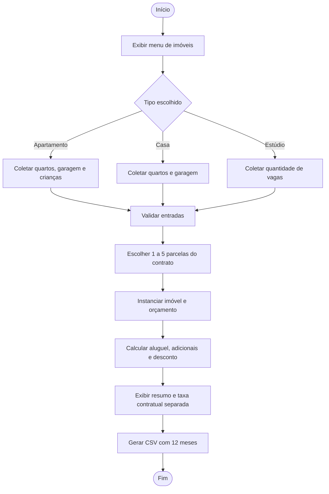

# RentSmart — R.M. Imóveis

Sistema de orçamento de locação desenvolvido em Python para automatizar o cálculo do aluguel, adicionais, descontos e taxa contratual, além de gerar uma projeção dos primeiros 12 meses em CSV.

## 1. Requisitos

- Python 3.10 ou superior
- Não utiliza bibliotecas externas: apenas módulos nativos do Python.

## 2. Como executar

1. Baixe ou clone este repositório.
2. Abra a pasta `RentSmart` no VS Code ou terminal.
3. Execute:

```bash
python main.py
```

No Windows, se o comando acima não funcionar, tente `py main.py`.

O programa solicitará o tipo de imóvel, suas características e a quantidade de parcelas da taxa contratual. Ao final, exibirá o orçamento e criará `arquivos/projecao_locacao.csv`.

## 3. Regras de negócio implementadas

| Categoria | Regra |
|---|---|
| Apartamento | Base de R$ 700,00; 2º quarto + R$ 200,00 |
| Casa | Base de R$ 900,00; 2º quarto + R$ 250,00 |
| Apartamento/casa | Garagem + R$ 300,00 |
| Apartamento | Sem crianças: desconto de 5% após os adicionais |
| Estúdio | Base de R$ 1.200,00 |
| Estúdio | Pacote inicial de 2 vagas: R$ 250,00 |
| Estúdio | Cada vaga além das duas iniciais: R$ 60,00 |
| Contrato | Taxa única de R$ 2.000,00, parcelável de 1 a 5 vezes |

**Premissa adotada:** o desconto de 5% do apartamento incide sobre a soma do aluguel-base e dos adicionais aplicáveis (segundo quarto e garagem). A taxa contratual não recebe desconto. O estúdio possui pacote inicial de duas vagas obrigatório, conforme a descrição do caso.

## 4. Estrutura de arquivos

```text
RentSmart/
├── main.py              # Entrada e fluxo principal do programa
├── imovel.py            # Classe-base e classes Apartamento, Casa e Estudio
├── orcamento.py         # Regras do orçamento e apresentação do resumo
├── gerador_csv.py       # Geração da projeção de 12 meses
├── arquivos/
│   └── projecao_locacao.csv
├── docs/
│   └── documentacao.pdf
└── README.md
```

## 5. Organização orientada a objetos

- `Imovel`: classe abstrata que concentra a estrutura comum dos imóveis.
- `Apartamento`: especializa o cálculo para quartos, garagem e desconto.
- `Casa`: especializa o cálculo para quartos e garagem.
- `Estudio`: calcula o pacote de duas vagas e as vagas adicionais.
- `Orcamento`: recebe um objeto de imóvel e a quantidade de parcelas da taxa contratual.
- `gerar_projecao_csv`: separa a responsabilidade de exportar os 12 meses.

O uso de herança evita repetir a estrutura comum dos imóveis. O polimorfismo aparece quando `Orcamento` utiliza `calcular_aluguel()` e `detalhes_calculo()` sem precisar conhecer os detalhes internos de cada categoria. Os atributos principais são encapsulados e acessados por métodos/propriedades.

## 6. Fluxograma



## 7. Formato do CSV

O arquivo utiliza ponto e vírgula como separador e codificação UTF-8 com BOM para facilitar a abertura no Excel. As colunas são:

- `Mes`
- `Aluguel mensal (R$)`
- `Parcela contratual (R$)`
- `Total previsto no mes (R$)`

A taxa contratual aparece apenas nos meses correspondentes à quantidade de parcelas escolhida. O aluguel aparece nos 12 meses.

## 8. Teste sugerido para demonstração

Escolha **apartamento**, 2 quartos, com garagem e sem crianças, e taxa contratual em 5 parcelas.

Cálculo esperado:
- Aluguel-base: R$ 700,00
- Segundo quarto: R$ 200,00
- Garagem: R$ 300,00
- Subtotal: R$ 1.200,00
- Desconto de 5%: R$ 60,00
- **Aluguel mensal: R$ 1.140,00**
- Taxa contratual: R$ 2.000,00 em 5 × R$ 400,00
- Total previsto nos meses 1 a 5: R$ 1.540,00 por mês
- Total previsto nos meses 6 a 12: R$ 1.140,00 por mês

## 9. Publicação no GitHub

1. Entre em [github.com](https://github.com/) e crie um repositório chamado `RentSmart`.
2. Deixe-o público, caso a instituição precise acessar sem autenticação.
3. Envie todos os arquivos desta pasta, mantendo a estrutura.
4. Confira se o `README.md` aparece na página inicial.
5. Copie o link do repositório para a entrega acadêmica.

## 10. Limitações e melhorias futuras

Esta versão é um protótipo acadêmico de terminal. Não possui banco de dados, cadastro persistente de clientes, interface gráfica ou assinatura de contrato. Esses recursos podem ser adicionados em versões futuras.
